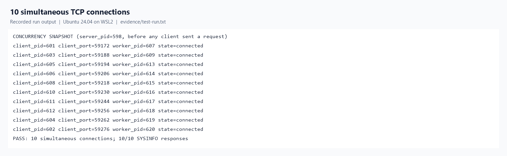
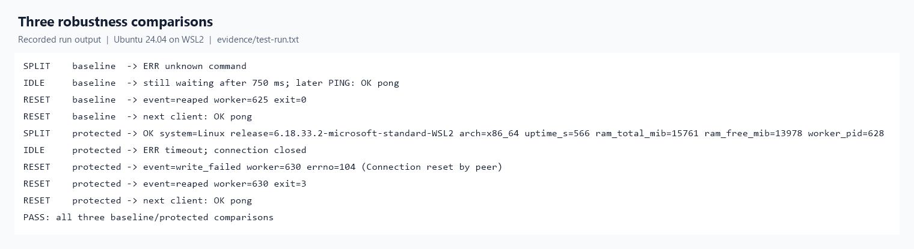
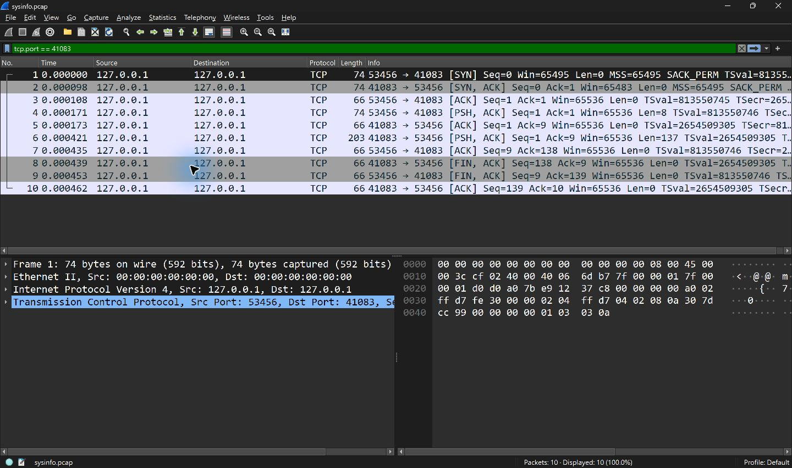
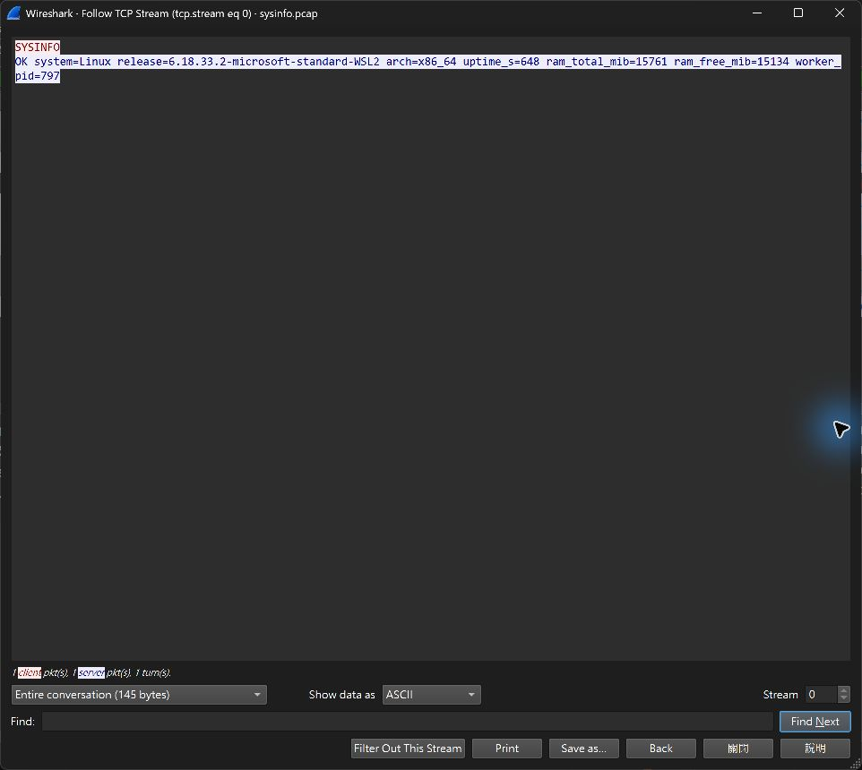

# Network and System Programming 期中專案報告

## 系統設計

`sysprogramming-midterm` 是以 C17 實作的 TCP 系統資訊服務，在 WSL2 的 Ubuntu 24.04 驗證。client 連上 `127.0.0.1`，送出一行命令。server 接受連線後以 `fork()` 交給子行程，父行程關閉該連線的描述符並繼續接受新連線。子行程關閉繼承的監聽描述符，回覆後關閉連線並退出。父行程透過 `signalfd()` 接收 `SIGCHLD`，再用 `waitpid(..., WNOHANG)` 回收子行程。

| 檔案 | 主要工作 |
| --- | --- |
| [src/server.c](src/server.c) | `serve()` 負責接受連線與建立子行程，`handle_request()` 負責處理請求，`system_info()` 透過 `uname()` 與 `sysinfo()` 取得資料。 |
| [src/client.c](src/client.c) | 解析命令列，透過共用函式連上 server、送出命令並讀取一行回應。 |
| [src/common.c](src/common.c) | `receive_line()` 根據換行界定一條訊息，以 `poll()` 和單調時鐘限制讀取時間。`send_all()` 處理部分寫入和 `EINTR`。 |
| [include/common.h](include/common.h) | 宣告共用函式、訊息大小和狀態。編譯時可以移除 Debug 呼叫。 |
| [Makefile](Makefile) | 建置 server、client、`libsysprogram.so` 和 C 測試。兩端都動態連結共用函式庫，以 `$ORIGIN` 從執行檔同一個目錄載入。 |
| [tests/test_suite.c](tests/test_suite.c) | 啟動 server 並驗證一般查詢、10 個同時連線的 client，以及三組防護前後的結果。 |

## 10 條同時連線

測試啟動 10 個 client 行程。各 client 連線後先等待，並將自己的 PID 和本機 TCP port 回報給測試程式。測試程式依 port 與 server 的接受連線紀錄配對，確認 10 個不同的子行程都存在後，才放行所有 client 傳送 `SYSINFO`。實際結果為 10 條連線同時建立，10 個 client 都收到成功回應。



## 三種異常及邊界情境

基準版以 `--baseline` 啟動，測試使用相同的 C client 邏輯及 server 選項。保護版在測試中使用 450 ms 讀取期限；回覆途中斷線的測試讓 server 先送出 `OK `，650 ms 後再送出剩餘內容。

| 情境與測試輸入 | 基準版實測 | 保護版實測 |
| --- | --- | --- |
| 請求分段抵達，先送 `SYS`，再送 `INFO\n` | 第一次 `recv()` 結束就解析，回覆 `ERR unknown command`。 | 等到換行才解析，回覆 `OK system=Linux ...`。 |
| client 連線後不送資料 | 等了 750 ms 仍無回覆，之後送 `PING` 仍得到 `OK pong`。 | 讀取期限屆滿後回覆 `ERR timeout`，隨即關閉連線。 |
| client 收到 `OK ` 後用 TCP RST 中止連線 | 子行程忽略寫入錯誤，父行程回收到 `exit=0`。 | 寫入使用 `MSG_NOSIGNAL`，子行程記錄 `errno=104`（連線被對端重設），父行程回收到 `exit=3`。 |

斷線測試後，兩種模式的下一條新連線都成功回覆 `OK pong`。下圖由保存的實測紀錄排版，完整內容見 [test-run.txt](evidence/test-run.txt)。



## 兩層 Debug 日誌

編譯時用 `make DEBUG=1`（預設）保留 Debug 日誌，用 `make DEBUG=0` 移除。執行時以 `--debug` 開啟日誌。檢查結果顯示，只有 `DEBUG=1` 的 client 加上 `--debug` 才在 `OK pong` 之前印出 `event=request`；`DEBUG=0` 建置的動態函式庫沒有 `debug_log` 符號。[四組執行結果](evidence/debug-check.txt)

## Loopback 封包擷取與分析

在 Ubuntu 以 `tcpdump` 監聽 `lo`，過濾 `127.0.0.1` 上的 TCP port `41083`。擷取到 10 個封包，核心回報 0 個丟棄。此連線的 client port 為 `53456`。

| 封包 | 分析 |
| --- | --- |
| 1–3 | client 送 SYN、server 回 SYN-ACK、client 回 ACK，完成 TCP 三向交握。 |
| 4–5 | client 送出 8 bytes 的 `SYSINFO\n`。server 的 ACK 確認這 8 bytes。 |
| 6–7 | server 送出 137 bytes 的 `OK system=Linux ...\n` 回應，client 回 ACK。 |
| 8–10 | server 先送 FIN-ACK，client 以 FIN-ACK 確認並關閉自己的傳送端，server 回最後一個 ACK。 |

可用 `tcpdump -nn -tttt -S -r evidence/sysinfo.pcap` 查閱 TCP 標誌、序號與確認號，用 `tcpdump -nn -A -r evidence/sysinfo.pcap` 核對文字內容。[封包清單](evidence/packet-summary.txt) · [原始 pcap](evidence/sysinfo.pcap) · [該次 client 輸出](evidence/capture-query.txt)

### Wireshark 截圖

在 Wireshark 開啟同一份 `sysinfo.pcap`，套用顯示過濾器 `tcp.port == 41083`。封包 1–3 是三向交握，封包 4 和 6 分別帶有 8 bytes 的請求和 137 bytes 的回應，封包 8–10 完成關閉連線。



對封包 4 按右鍵，選擇 **Follow → TCP Stream**。ASCII 畫面顯示 client 的 `SYSINFO` 和 server 的 `OK system=Linux ...`，兩個方向合計 145 bytes。



重做封包擷取時，在三個 Ubuntu 終端機分別執行下列命令。三個終端機都先切到專案目錄。等 `tcpdump` 顯示 `listening on lo` 後再執行 client，執行完在前兩個終端機各按 Ctrl+C。每次使用新的 pcap 檔名。

```sh
# 終端機 1
./build/debug1/server --port 39085

# 終端機 2
sudo tcpdump -p -i lo -U -Z "$(id -un)" -w evidence/replay.pcap 'tcp port 39085 and host 127.0.0.1'

# 終端機 3
./build/debug1/client --port 39085 SYSINFO
```
